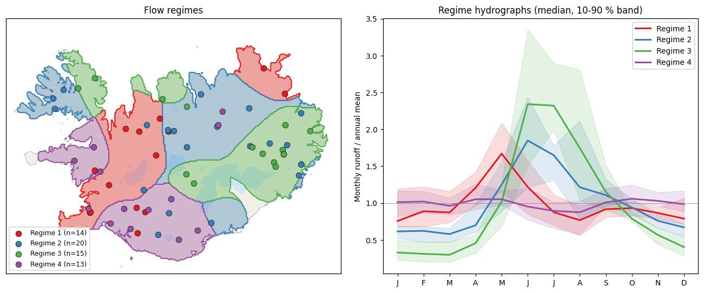
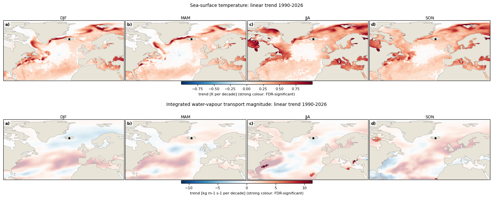
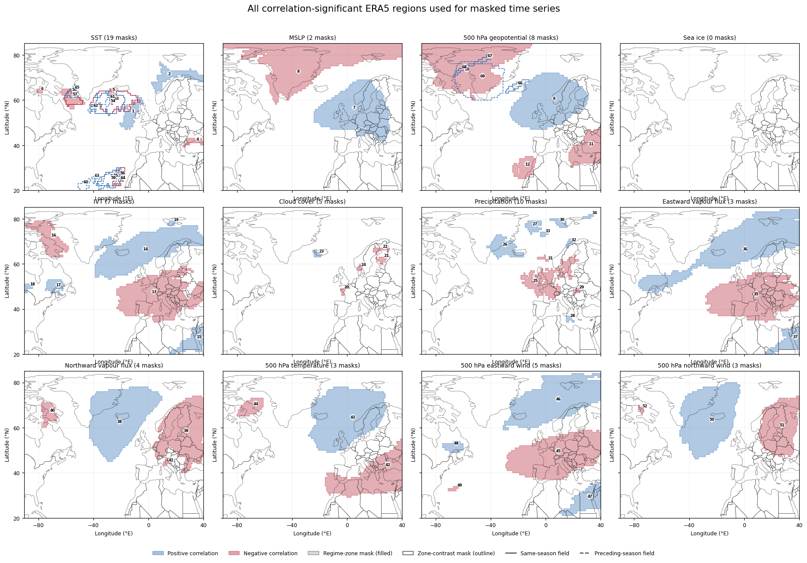
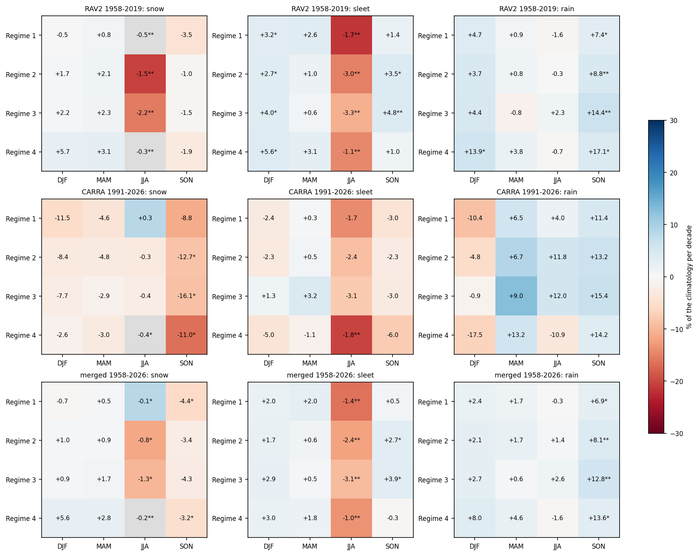
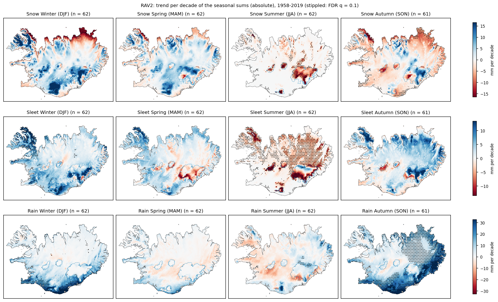

# Drivers of Hydrological Variability in Iceland

```
                         +-----------------------------------------------+
                         |       Ocean-Atmospheric Forcing               |
                         | NAO, EA, SCAN, Blocking                       |
                         | AMOC / SPG Dynamics, Atmospheric Rivers       |
                         +----------------------+------------------------+
                                                |
                     +--------------------------+--------------------------+
                     v                                                     v
+-----------------------------------------+   +-----------------------------------------+
| Precipitation & Thermal Regimes         |   | Ocean-Cryosphere Interface              |
| Orographic lift & rain shadows          |   | SST anomalies & marine moisture         |
| Rain-on-snow (ROS) events               |   | Sea ice extent & coastal feedback       |
+------------------------+----------------+   +------------------------+----------------+
                         |                                            |
                         +---------------------------+----------------+
                                                     v
                        [ Hydro-Cryospheric Response Units ]
                                                     |
                         +---------------------------+--------------------------+
                         v                           v                          v
+---------------------------------+ +---------------------------------+ +---------------------------------+
| River Discharge                 | | Seasonal Snowpack               | | Glacier Mass Balance            |
| Direct runoff & floods          | | Snow water equivalent (SWE)     | | Winter accumulation (B_w)       |
| Spring freshet timing           | | Albedo decay / dust events      | | Summer ablation (B_s)           |
| Groundwater attenuation         | | Elevation gradient shifts       | | Equilibrium Line Altitude       |
+---------------------------------+ +---------------------------------+ +---------------------------------+
```

## Project Overview

This project investigates the drivers of hydrological variability in Iceland. This page summarises the objective and the main results so far (October 2026, work in progress; all results are exploratory).

## Objective

Identify what drives year-to-year and long-term changes in Icelandic river flow and groundwater, from the large-scale ocean and atmosphere down to the precipitation that reaches the catchments:

1. **Describe the response**: when and where is flow (and groundwater level) variable, and can the gauges be grouped into regimes that behave alike?
2. **Large-scale drivers**: which ocean and atmosphere patterns (sea-surface temperature, pressure and circulation, water-vapour transport) are linked to the runoff of each regime, and how have they changed?
3. **Small-scale drivers**: how are precipitation amount, phase (snow, sleet, rain) and the wind direction it arrives with changing across Iceland, and how does that map onto the regimes?
4. **Predictability**: can the large-scale state be used to forecast seasonal runoff anomalies?

Reference period for all anomalies and climatologies is **1990-2020**. Seasons are DJF, MAM, JJA and SON.

## Data

| Data | Used for | Period |
|---|---|---|
| LamaH-Ice daily discharge + WISKI extensions | flow regimes, runoff anomalies (62 non-regulated gauges) | 1981-2026 |
| Groundwater levels (19 wells at 6 sites) | groundwater variability | varies |
| ERA5 (monthly, 1 degree seasonal cache) | SST, MSLP, Z500, T500, winds, IVT, vapour fluxes, cloud, sea ice, precipitation | 1981-2026 |
| RAV2 (Belgingur WRF reanalysis, 2 km, hourly) | precipitation phase and wind-direction partitioning | 1957-2019 |
| CARRA (2.5 km, 3-hourly) | same, extended to the present | 1991-2026 |

## 1. Flow regimes: how the gauges were classified



Daily discharge was converted to specific runoff, screened and aggregated to seasons. The 62 gauges with enough valid years were clustered (k-means, K = 4) on the **seasonal shares of annual runoff**, so the shape of the hydrograph defines the regime and variability metrics remain an independent result. `seasonal_flow_variability.ipynb`

| Regime | Gauges | Hydrograph | Glaciated share | Share of runoff in the peak season |
|---|---|---|---|---|
| 1 | 14 | spring peak (MAM), snowmelt-dominated (interpretation) | 0 % | MAM 30 % |
| 2 | 20 | summer peak (JJA), mixed snow and glacier melt | 7 % | JJA 40 % |
| 3 | 15 | strong summer peak (JJA), glacier-fed | 14 % | JJA 57 % |
| 4 | 13 | flat hydrograph, rain and groundwater-fed (interpretation; south and southwest) | 0 % | about 25 % in every season |

- Interannual variability (CV of seasonal means) is about 0.21-0.23 across seasons. Within-season daily variability is lowest in summer (0.36) and highest in spring (0.70). Regime 3 is the most variable and regime 4 the least.
- The regimes wet and dry **together** year to year: correlations between regimes are 0.67-0.84 in winter and 0.61-0.93 in spring, and weaker in summer (0.31-0.71) and autumn (0.39-0.72), when the glacier and snow regimes respond differently. Opposite wet/dry extremes in two regimes are rare.
- Groundwater (19 wells, 6 sites, all in the south-central highlands) has very persistent anomalies (lag-1 autocorrelation about 0.9) and four well clusters that differ mostly in the magnitude of variability. `seasonal_groundwater_variability.ipynb`

**Change in flow behaviour, 1990-2026** (trend of the regime-mean runoff z-score, Mann-Kendall):

| Regime | Season | Trend per decade | p |
|---|---|---|---|
| 2 | MAM | +0.37 z | 0.004 |
| 2 | SON | +0.30 z | 0.004 |
| 3 | MAM | +0.30 z | 0.04 |
| 3 | JJA | -0.27 z | 0.001 |

Spring and autumn runoff has risen in the snow/glacier regimes and summer runoff has fallen in the glacier-fed regime. This pattern is consistent with an earlier melt season and more liquid precipitation, but this has not been tested directly. The other regime-season combinations show no significant change.

## 2. Large-scale drivers (ERA5)

Notebooks: `code/notebooks/large-scale-driver/` (00-10)

### What has changed (linear trends 1990-2026)



- **The ocean around Iceland has warmed clearly.** Area-mean SST in 60-70 N, 30-10 W rises by **0.23-0.30 K per decade** in every season (p < 0.01). The strongest and FDR-significant warming is along the subpolar gyre boundary and in the Nordic Seas.
- **Water vapour transport has not changed significantly.** Over the same box, integrated water-vapour transport changes by -5 % (DJF) to +6.5 % (MAM) per decade and total precipitation by -0.6 to +2.3 % per decade, none significant (p > 0.09). The eastward vapour flux decreases in all seasons, and the northward flux increases in spring, but neither is significant. Only isolated FDR-significant cells appear (e.g. the western subtropical Atlantic in summer).
- 500 hPa temperature rises (JJA +0.32 K per decade, p = 0.02); geopotential height and MSLP show no significant change near Iceland.

So the large-scale record shows a clear **thermal** change (warmer ocean and mid-troposphere) but no robust change in the **moisture supply** itself. Changes in what falls as snow, sleet and rain (section 3) are therefore expected to come mainly from temperature, not from more moisture.

### What is linked to runoff



- Grid-cell correlations between seasonal ERA5 anomalies and regime runoff (same season and preceding season, detrended, FDR-controlled) identify 69 persistent regions (SST 19, precipitation 10, geopotential 8, IVT 7, and others). Regions of positive and negative correlation form dipoles, for example an IVT and eastward vapour-flux contrast between the northeast Atlantic and central Europe.
- EOF modes of the ERA5 fields versus regime runoff: 57 of 576 combinations pass FDR control. The strongest are the 500 hPa northward wind EOF2 in spring (r = 0.68 for regime 4 and 0.67 for regime 1) and the MSLP EOF3 in winter (r = 0.55-0.59). MSLP (11) and northward water-vapour flux (10) account for the most significant links, so **southerly circulation and moisture transport matter most for runoff**.
- Trends in the correlation-region indices: 28 of 276 are significant (AR(1)-adjusted, FDR), nearly all SST (warming 0.2-0.7 K per decade), 500 hPa temperature and geopotential. No significant change points were found.
- These regions were selected with the full period, so their trends and correlations are selection-biased and not independent tests.

### Seasonal forecasting: no skill yet

Rolling-origin and nested ridge/lasso/elastic-net forecasts of regime runoff anomalies from ERA5 predictors (preceding season) do **not** beat a zero-anomaly climatological forecast. Pooled RMSE skill is between -0.4 % (SST-only ridge) and -25 % (nested selection) over 160 forecasts, with correlations close to zero. The correlations in the maps are therefore descriptive and do not (yet) translate into out-of-sample skill.

## 3. Small-scale drivers (RAV2 and CARRA)

Notebooks: `code/notebooks/small-scale-drivers/` | extraction: `small_scale_extract.py`

Both reanalyses were processed from the sub-daily output into monthly fields on their native grids. Each time step's precipitation is classified as **snow** (T2 <= -1 degC), **sleet** (-1 to +1 degC) or **rain** (>= +1 degC), and separately by the **10 m wind direction** it arrives with (eight 45-degree sectors, as in `carra_tools_py.group_precip_wd`).

**Climate of the partitioning (CARRA, 1991-2020 mean, by regime)**

| Regime | Annual precipitation | Snow | Sleet | Rain |
|---|---|---|---|---|
| 1 | 1320 mm | 30 % | 18 % | 52 % |
| 2 | 1450 mm | 43 % | 17 % | 40 % |
| 3 | 1700 mm | 45 % | 19 % | 36 % |
| 4 | 1890 mm | 21 % | 16 % | 63 % |



*Rows: RAV2 (1958-2019), CARRA (1991-2026), merged (RAV2 before 1991, CARRA after). Numbers: mm per season per decade; * p < 0.05, ** p < 0.01; blue is an increase, red a decrease.*

- **Autumn rain is increasing in every regime**, by 7-14 mm per season per decade (+3 to +6 % per decade) in the merged series. This is the clearest change, and autumn snow decreases in regimes 1 and 4.
- **Summer snow and sleet decrease** in all regimes (sleet -10 to -16 % per decade), the signature of a warming summer. Winter rain increases in regime 4 in RAV2 (+14 mm per decade, p < 0.05), while CARRA, over its much shorter period, has the opposite sign (not significant).
- Total precipitation changes are small: only regime 4 in winter (+17 mm per decade) and regime 3 in autumn are significant. This agrees with the lack of a moisture-transport trend in section 2.
- RAV2 and CARRA agree on the sign for the most robust signals. CARRA alone covers a short period (1991-2026) and mostly gives non-significant trends.



*RAV2 trends per decade of seasonal snow, sleet and rain (stippling: FDR-significant). Blue is more precipitation, red less.*

- Spatially, the rain increase in autumn is strongest and significant in the south and east, and the winter rain increase along the south coast. Snow decreases on the northern and eastern coasts and in summer on the glacier margins, while it increases in the high terrain of the Westfjords and the glacier interiors in winter (more precipitation falling as snow at high elevation).
- **Wind direction** (notebook 02): precipitation in the south and southeast arrives mostly with southeasterly and southerly winds (SE and S together 40-50 % of winter precipitation in regimes 1 and 4), whereas the north and glacier regimes (2 and 3) get a larger share from N-NE flow in summer and autumn. Sector trend maps are produced for both datasets but are exploratory and not yet interpreted.

## Caveats

- Trends are OLS or Theil-Sen with a Mann-Kendall p-value and no general adjustment for autocorrelation (except where stated), and multiple-testing control (FDR) only where noted.
- The reanalyses are not bias-corrected. Relative changes are more reliable than absolute amounts, and the sleet share is not directly comparable between RAV2 (hourly) and CARRA (3-hourly).
- The merged RAV2/CARRA series may have a break at the 1991 join.
- The ERA5 regions and indices were selected using the full record and should not be read as out-of-sample evidence.

## Next steps

- Link the small-scale changes (autumn rain, summer snow loss) to the observed regime runoff changes (spring and autumn increase, summer decrease in regime 3) with the same catchments and seasons.
- Quantify how much of the runoff change is explained by phase change versus total precipitation and by large-scale circulation.
- Interpret the wind-sector trends together with the large-scale circulation (EOF/pressure patterns).
- Repeat the forecast evaluation with predictors selected only on training data.

## Repository layout

```
code/notebooks/                  (local analysis code, not part of this overview)
  flow-groundwater-variabilty/   flow regimes, groundwater variability
  large-scale-driver/            ERA5 trends, EOFs, correlations, forecasts (00-10)
  small-scale-drivers/           RAV2/CARRA precipitation phase and wind direction (00-02) + extraction script
docs/figures/                    the overview figures shown above
data/, image/, old/              inputs, derived data, all other figures and archived material
```

The small-scale fields are produced with `python small_scale_extract.py carra|rav2` (run from `code/notebooks/small-scale-drivers/`) before the notebooks.
